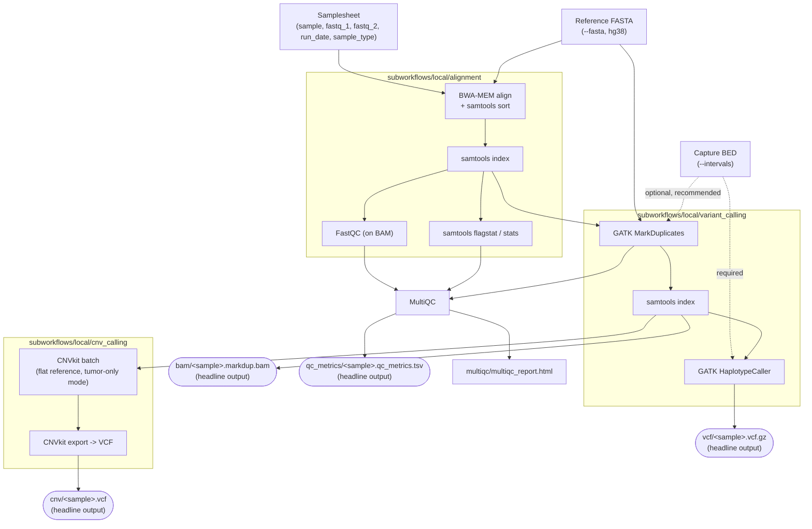

# kpipho/varcall

**A germline variant-calling pipeline for human whole-exome sequencing (WES) data, built against the hg38 reference.** It aligns paired-end Illumina reads with BWA-MEM, marks duplicates and calls short variants (SNVs/indels) with GATK, calls copy-number variants with CNVkit, and reports QC at every stage with FastQC, samtools and MultiQC. Built with the official [nf-core](https://nf-co.re/) pipeline template and designed to run on a Linux HPC cluster via Singularity.

## Table of contents

- [Workflow summary](#workflow-summary)
- [File key](#file-key)
- [Requirements](#requirements)
- [Usage](#usage)
- [Outputs](#outputs)
- [Testing](#testing)
- [Troubleshooting / FAQ](#troubleshooting--faq)
- [Customizing and fine-tuning the tools used](#customizing-and-fine-tuning-the-tools-used)
- [How this pipeline was built and validated](#how-this-pipeline-was-built-and-validated)
- [Credits, contributing and citations](#credits-contributing-and-citations)

## Workflow summary



1. **Align** paired-end reads to the reference with [BWA-MEM](https://github.com/lh3/bwa), piped directly into `samtools sort` so the output BAM is already coordinate-sorted, then indexed.
2. **Alignment QC**: [FastQC](https://www.bioinformatics.babraham.ac.uk/projects/fastqc/) run directly on the aligned BAM, plus `samtools flagstat`/`stats` for mapping-rate, insert-size and coverage metrics.
3. **Mark duplicates** with GATK `MarkDuplicates`, then call germline short variants (SNVs/indels) with GATK `HaplotypeCaller` - restricted to `--intervals` (+100bp padding) when supplied, which is essential for exome data since most of the genome has no coverage at all.
4. **Call copy-number variants** with [CNVkit](https://cnvkit.readthedocs.io/) in germline/tumor-only mode (no matched normal, no panel of normals - a "flat" internal reference), over the `--intervals` capture regions. This subworkflow requires `--intervals`.
5. **Aggregate QC** into one [MultiQC](http://multiqc.info/) HTML report and republish its general-stats table as one flat, tabular QC metrics TSV.

Four headline outputs, one set per sample, under `--outdir`:

| Output                     | Path                                 | Produced by                               |
| -------------------------- | ------------------------------------ | ----------------------------------------- |
| Analysis-ready BAM         | `bam/<sample>.markdup.bam(.bai)`     | `variant_calling` (post-dedup)            |
| Germline short-variant VCF | `vcf/<sample>.vcf.gz(.tbi)`          | `variant_calling` (HaplotypeCaller)       |
| Copy-number VCF            | `cnv/<sample>.vcf`                   | `cnv_calling` (CNVkit)                    |
| Flat QC metrics table      | `qc_metrics/<sample>.qc_metrics.tsv` | MultiQC general-stats, republished as TSV |

See [`docs/output.md`](docs/output.md) for the complete output directory layout, including intermediate files.

## File key

```
.
├── main.nf                          Entrypoint: parameter/samplesheet init -> workflows/varcall.nf -> completion
├── workflows/varcall.nf             Top-level wiring: ALIGNMENT -> VARIANT_CALLING -> CNV_CALLING -> MultiQC -> QC table
├── nextflow.config                  Global params, container engine profiles (incl. `singularity`, `test`), manifest
├── nextflow_schema.json             JSON-schema parameter definitions (validated at runtime by the nf-schema plugin)
│
├── subworkflows/local/
│   ├── alignment/main.nf            BWA_INDEX, BWA_MEM, SAMTOOLS_FAIDX/INDEX/FLAGSTAT/STATS, FASTQC
│   ├── variant_calling/main.nf      GATK4_CREATESEQUENCEDICTIONARY, GATK4_MARKDUPLICATES, SAMTOOLS_INDEX, GATK4_HAPLOTYPECALLER
│   ├── cnv_calling/main.nf          CNVKIT_BATCH, CNVKIT_EXPORT
│   └── utils_nfcore_varcall_pipeline/main.nf   nf-core template plumbing: samplesheet parsing, --help text, version collation
│
├── modules/
│   ├── local/qc_metrics_table/      The one hand-written process: republishes MultiQC's general-stats table as a flat TSV
│   └── nf-core/                     Unmodified nf-core modules (bwa, samtools, gatk4, cnvkit, fastqc, multiqc) -
│                                    installed via `nf-core modules install`, never hand-edited (see "Customizing" below)
├── subworkflows/nf-core/            Unmodified nf-core template subworkflows (parameter validation, version reporting)
│
├── conf/
│   ├── base.config                 Default per-label (process_low/medium/high/...) CPU/memory/time, sized for exome+hg38
│   ├── modules.config               Per-process publishDir layout + ext.args/ext.prefix/resource overrides
│   └── test.config                  The `-profile test` profile: points at tests/data/, caps resources for a laptop
│
├── assets/
│   ├── schema_input.json            Samplesheet JSON schema: paired-end only, 5 required columns
│   ├── samplesheet.csv              Example samplesheet
│   └── multiqc_config.yml           MultiQC report customisation
│
├── docs/
│   ├── usage.md                     Full parameter/samplesheet reference
│   ├── output.md                    Full output directory reference
│   └── CONTRIBUTING.md              Contribution conventions
│
├── tests/
│   ├── generate_test_data.py        Deterministically generates a tiny synthetic 2-sample test dataset (not committed)
│   ├── run_tests.sh                 Runs the pipeline against it + 2 negative tests; see "Testing" below
│   └── README.md                    Test suite reference
│
├── modules.json                     nf-core module/subworkflow provenance (versions, git SHAs) - edited by `nf-core modules`
├── .nf-core.yml                     nf-core lint configuration + record of template creation options
├── CITATIONS.md                     Full tool citation list
├── CLAUDE.md                        Orientation notes for AI coding agents working in this repo (architecture, gotchas)
└── SESSION_TRANSCRIPT.txt           Full prompt/command log from the sessions that built this pipeline
```

## Requirements

- [Nextflow](https://www.nextflow.io/) `>=25.10.4` (a Java runtime is required to run Nextflow itself; Nextflow does not need to be able to see Java elsewhere, it bundles its own launcher logic)
- One of: [Singularity](https://sylabs.io/singularity/) / [Apptainer](https://apptainer.org/) (the primary target - every module resolves its own container inline, no image building needed), [Docker](https://www.docker.com/), or [Conda](https://docs.conda.io/) (last resort - see [nf-core's guidance](https://nf-co.re/docs/usage/getting_started/configuration#3-containers))
- A reference genome FASTA (hg38) and, for exome data, a capture kit BED file
- No separate install of BWA/GATK/CNVkit/samtools/FastQC/MultiQC - these are all pulled automatically as containers per-process

## Usage

> [!NOTE]
> New to Nextflow/nf-core? See [this page](https://nf-co.re/docs/usage/getting_started/introduction) first.

**1. Prepare a samplesheet** (5 columns, header row, paired-end only):

```csv title="samplesheet.csv"
sample,fastq_1,fastq_2,run_date,sample_type
SAMPLE_1,/path/to/fastq/SAMPLE_1_R1_001.fastq.gz,/path/to/fastq/SAMPLE_1_R2_001.fastq.gz,2026-01-15,tumor
SAMPLE_2,/path/to/fastq/SAMPLE_2_R1_001.fastq.gz,/path/to/fastq/SAMPLE_2_R2_001.fastq.gz,2026-01-15,normal
```

| Column        | Description                                                       |
| ------------- | ----------------------------------------------------------------- |
| `sample`      | Unique sample ID, no spaces                                       |
| `fastq_1`     | Forward/R1 FASTQ (`.fastq.gz`/`.fq.gz`)                           |
| `fastq_2`     | Reverse/R2 FASTQ - **required**; this pipeline is paired-end only |
| `run_date`    | ISO-8601 date (`YYYY-MM-DD`) the sample was sequenced             |
| `sample_type` | Free-text, e.g. `tumor`, `normal`, `control`                      |

`run_date`/`sample_type` are carried through as part of each sample's metadata map alongside `id`, available to any process that needs to route or tag by them. Full column reference: [`docs/usage.md`](docs/usage.md).

**2. Run the pipeline:**

```bash
nextflow run kpipho/varcall \
   -profile singularity \
   --input samplesheet.csv \
   --fasta genome.fa \
   --intervals capture_targets.bed \
   --outdir <OUTDIR>
```

- `--fasta` (required): the reference genome. The BWA index, `.fai` index and GATK sequence dictionary are built automatically on first use; on an HPC system where the reference is reused across many runs, pass pre-built ones via `--bwa_index`/`--fasta_fai`/`--dict` to skip rebuilding them.
- `--intervals` (your exome capture kit's target regions, as a **BED** file - CNVkit needs BED specifically): strongly recommended for exome data (restricts `HaplotypeCaller` to the covered regions instead of scanning the whole genome) and **required** for CNV calling - `cnv_calling` errors out immediately and clearly if it's missing. See [`docs/usage.md`](docs/usage.md#exome-capture-regions---intervals).

See [`docs/usage.md`](docs/usage.md) for every parameter, and `nextflow run kpipho/varcall --help` for the full auto-generated parameter listing.

> [!WARNING]
> Provide pipeline parameters via the CLI or a Nextflow `-params-file`. Custom config files passed with `-c` should only be used for infrastructure/resource tuning, never for parameters - see [nf-core's docs](https://nf-co.re/docs/usage/getting_started/configuration#custom-configuration).

### Running on an HPC cluster

Set `process.executor` (e.g. `slurm`, `sge`, `pbspro`) and queue/partition details in a site config, then add it with `-c`:

```bash
nextflow run kpipho/varcall -profile singularity -c /path/to/your_hpc.config --input ... --fasta ... --outdir ...
```

Many institutions already have a ready-made config in [nf-core/configs](https://github.com/nf-core/configs) - check there before writing your own. See ["Customizing and fine-tuning"](#customizing-and-fine-tuning-the-tools-used) below for resource-tuning specifics.

## Outputs

Four headline outputs per sample (`bam/`, `vcf/`, `cnv/`, `qc_metrics/`) plus intermediate alignment artifacts, per-tool QC reports, the aggregated MultiQC report, and Nextflow execution reports. Full reference, including every intermediate file: [`docs/output.md`](docs/output.md).

## Testing

A self-contained correctness test suite lives in [`tests/`](tests/) - run it after installing the pipeline on a new system (e.g. right after cloning onto an HPC cluster, or after pulling a new container/module version) to confirm Nextflow, Singularity, and the pipeline code all actually work together, **before** pointing the pipeline at real patient data. It needs nothing beyond what the pipeline itself needs: `nextflow`, `singularity`, and `python3` (standard library only) - no nf-test, no other language toolchain, no network access beyond the usual first-run container pulls.

### Running it

```bash
tests/run_tests.sh
```

This takes a few minutes on first run (it pulls containers, same as any real pipeline run; subsequent runs reuse the Singularity image cache). It prints a `[PASS]`/`[FAIL]` line per check and a summary, and **exits non-zero if anything failed** - safe to use as an install-verification gate:

```bash
tests/run_tests.sh && echo "pipeline is working correctly on this system"
```

Pass extra arguments straight through to every `nextflow run` call it makes, e.g. to add HPC-specific config:

```bash
tests/run_tests.sh -c /path/to/your_hpc.config
```

### What it actually checks

1. **Full pipeline run.** `generate_test_data.py` deterministically builds (fixed random seed - always byte-identical output) a ~30kb synthetic reference, ten scattered ~200bp "capture target" regions, and paired-end reads for two samples - mostly sampled from the capture regions plus a bit of off-target noise, like real exome data - **each with one deliberately injected heterozygous SNP inside a capture region**. `run_tests.sh` then runs `alignment` → `variant_calling` → `cnv_calling` → QC via `-profile test,singularity` (`conf/test.config`), and checks:
   - all four headline outputs exist for **both** samples (BAM+index, VCF+index, CNV VCF)
   - **each sample's germline VCF contains the exact injected SNP** (chrom:pos:ref>alt), checked against `tests/data/expected_variants.tsv` - this is the check that actually proves variant calling works correctly, not just "the pipeline didn't crash"
   - the QC metrics TSV has exactly one row per sample
   - the MultiQC report was produced
2. **Samplesheet validation.** Runs the pipeline against a samplesheet with a blank `fastq_2` value (violates the paired-end-only schema) and confirms it is **rejected**. A schema check that silently stops validating is worse than no schema check at all, because it fails open - this is as important to test as the happy path.
3. **`cnv_calling` requires `--intervals`.** Confirms that running without `--intervals` fails fast with the expected error, rather than silently producing meaningless CNV calls.

Full details, including the exact file layout generated under `tests/data/` (gitignored, regenerated on demand) and how to extend the suite: [`tests/README.md`](tests/README.md).

### Running just the happy path yourself

```bash
python3 tests/generate_test_data.py
nextflow run . -profile test,singularity --outdir test_results
```

## Troubleshooting / FAQ

**Singularity image pull fails / times out on the HPC login node or compute node.**
Container images are pulled from `community-cr-prod.seqera.io` and `depot.galaxyproject.org` on first use - confirm the node that runs the pull has outbound internet access (many HPC compute nodes don't; pull once on the login node, or `-profile test` locally, so the images land in the shared `NXF_SINGULARITY_CACHEDIR` before submitting to compute nodes). Set `NXF_SINGULARITY_CACHEDIR` to a shared, persistent directory - otherwise Nextflow warns and caches images under the (often ephemeral) work directory, and every new work directory re-downloads everything.

**A process fails with an out-of-memory or "exceeded... memory limit" error from the scheduler.**
`conf/base.config`/`conf/modules.config`'s resource requests are sized for _exome_ data against _hg38_; if your capture kit, coverage, or reference differs meaningfully, override the specific process (see ["Customizing"](#customizing-and-fine-tuning-the-tools-used) below) rather than editing the shipped defaults in place.

**"CNV_CALLING requires --intervals..." error.**
This is intentional, not a bug: CNVkit's target/antitarget binning is meaningless without capture regions. Supply `--intervals /path/to/capture.bed` (must be BED format for CNVkit - a GATK `.interval_list` works for `--intervals` elsewhere in the pipeline but not here).

**Samplesheet is rejected with a schema validation error.**
Almost always one of: a missing/empty `fastq_2` value (single-end data isn't supported), a `run_date` not in `YYYY-MM-DD` format, or a `sample_type`/`sample` value containing a space. Run `tests/run_tests.sh` once if you're unsure the schema itself is behaving as expected on your system - its second test deliberately exercises this exact rejection path.

**Re-running after editing `conf/modules.config` reruns everything from scratch instead of resuming.**
Expected: `-resume` cache keys include each process's resolved config (including `ext.args`/`ext.prefix`/resource requests), so any config change downstream of a given process invalidates its cache and everything after it.

**"Pipeline failed" with no further Nextflow-level detail.**
Check `.nextflow.log` and the specific failed task's `work/<hash>/.command.log` / `.command.err` (the path is printed in the error block) - these contain the actual tool's (BWA/GATK/CNVkit/etc.) error output, which is almost always more informative than Nextflow's own summary.

**I want to reuse a pre-built BWA index / `.fai` / sequence dictionary instead of rebuilding them every run.**
Pass `--bwa_index`, `--fasta_fai`, `--dict` respectively - see [`docs/usage.md`](docs/usage.md#reference-genome). Particularly worthwhile on an HPC where the same hg38 reference is reused across many pipeline runs.

**Can I run this on a cohort / add joint genotyping across samples?**
Not currently wired up - `HaplotypeCaller` runs independently per sample. See ["Customizing"](#customizing-and-fine-tuning-the-tools-used) for where to add `-ERC GVCF` + `GenomicsDBImport`/`GenotypeGVCFs` if you need joint calling.

## Customizing and fine-tuning the tools used

Every tool-specific knob lives in **`conf/modules.config`** via `ext.args` (extra CLI arguments appended verbatim to the tool's command) and per-process resource overrides (`cpus`/`memory`/`time`) - that's the file to edit, not the module files themselves (the `modules/nf-core/` and `subworkflows/nf-core/` directories are unmodified upstream copies, installed with `nf-core modules install`/`nf-core subworkflows install`, and should be kept that way so they can be cleanly updated later; see `nf-core modules update`). Each process selector in `conf/modules.config` has a comment pointing at the specific tunable most people reach for first (e.g. `-ERC GVCF` for HaplotypeCaller, `--REMOVE_DUPLICATES true` for MarkDuplicates).

Resource defaults (`conf/base.config`'s `process_low`/`process_medium`/`process_high`/... labels, plus the explicit per-process overrides for `BWA_INDEX`/`GATK4_MARKDUPLICATES`/`GATK4_HAPLOTYPECALLER`/`CNVKIT_BATCH`) are deliberately tuned for exome data against the full hg38 reference - the rationale is written out in comments at the top of both `conf/base.config` and `conf/modules.config`. Don't edit the shipped files in place for one-off or site-specific tuning; add a `-c your_overrides.config` instead (same `withLabel`/`withName` selectors, different numbers) - see [Nextflow's config docs on process selectors](https://www.nextflow.io/docs/latest/config.html#process-selectors) and [nf-core's guide to tuning resources](https://nf-co.re/docs/usage/getting_started/configuration#max-job-request-options).

Where to go deeper on each tool:

| Tool                                                                 | What it does here                                         | Docs / tuning reference                                                                                                                                                                                                                                                                                                                                                                                                                                                                                                        |
| -------------------------------------------------------------------- | --------------------------------------------------------- | ------------------------------------------------------------------------------------------------------------------------------------------------------------------------------------------------------------------------------------------------------------------------------------------------------------------------------------------------------------------------------------------------------------------------------------------------------------------------------------------------------------------------------ |
| [Nextflow](https://www.nextflow.io/)                                 | Workflow engine                                           | [Docs](https://www.nextflow.io/docs/latest/index.html) · [Config reference](https://www.nextflow.io/docs/latest/config.html) · [Process directives](https://www.nextflow.io/docs/latest/process.html)                                                                                                                                                                                                                                                                                                                          |
| [nf-core](https://nf-co.re/)                                         | Pipeline template, module/subworkflow repository, linting | [Docs](https://nf-co.re/docs) · [Module/subworkflow browser](https://nf-co.re/modules) · [Pipeline configuration guide](https://nf-co.re/docs/usage/getting_started/configuration)                                                                                                                                                                                                                                                                                                                                             |
| [BWA-MEM](https://github.com/lh3/bwa)                                | Alignment (`subworkflows/local/alignment`)                | [Manual](http://bio-bwa.sourceforge.net/bwa.shtml) · [nf-core module](https://nf-co.re/modules/bwa_mem)                                                                                                                                                                                                                                                                                                                                                                                                                        |
| [samtools](http://www.htslib.org/)                                   | Sort/index/flagstat/stats/faidx                           | [Manual](http://www.htslib.org/doc/samtools.html)                                                                                                                                                                                                                                                                                                                                                                                                                                                                              |
| [GATK](https://gatk.broadinstitute.org/)                             | MarkDuplicates, HaplotypeCaller, sequence dictionary      | [Tool docs index](https://gatk.broadinstitute.org/hc/en-us/categories/360002369672) · [HaplotypeCaller](https://gatk.broadinstitute.org/hc/en-us/articles/360037225632-HaplotypeCaller) · [MarkDuplicates](https://gatk.broadinstitute.org/hc/en-us/articles/360037052812-MarkDuplicates-Picard) · [Germline short-variant best-practices workflow](https://gatk.broadinstitute.org/hc/en-us/articles/360035535932-Germline-short-variant-discovery-SNPs-Indels-) (useful background for extending to joint genotyping / VQSR) |
| [CNVkit](https://cnvkit.readthedocs.io/)                             | Copy-number calling (`subworkflows/local/cnv_calling`)    | [Docs](https://cnvkit.readthedocs.io/en/stable/) · [Germline/tumor-only pipeline mode](https://cnvkit.readthedocs.io/en/stable/pipeline.html) · [Building a panel-of-normals reference](https://cnvkit.readthedocs.io/en/stable/fileformats.html#reference) (for more accurate calling than this pipeline's flat-reference default)                                                                                                                                                                                            |
| [FastQC](https://www.bioinformatics.babraham.ac.uk/projects/fastqc/) | Read/alignment QC                                         | [Help pages](https://www.bioinformatics.babraham.ac.uk/projects/fastqc/Help/)                                                                                                                                                                                                                                                                                                                                                                                                                                                  |
| [MultiQC](https://multiqc.info/)                                     | QC aggregation report                                     | [Docs](https://docs.seqera.io/multiqc) · [Configuration](https://docs.seqera.io/multiqc/customisation/config) (`assets/multiqc_config.yml` is where this pipeline's customisation lives)                                                                                                                                                                                                                                                                                                                                       |

## How this pipeline was built and validated

A detailed, chronological account of every prompt and shell command used to build this pipeline is in [`SESSION_TRANSCRIPT.txt`](SESSION_TRANSCRIPT.txt). Summary:

**Scaffolding.** Created with the official `nf-core pipelines create` (nf-core/tools v4.1.0, templated via a `template.yml` rather than the interactive TUI), as a standalone pipeline (not part of the nf-core organisation - `is_nfcore: false` in `.nf-core.yml`). CI/GitHub/nf-test template features were deliberately skipped at creation time (`skip_features` in `.nf-core.yml`) since this isn't hosted on GitHub Actions; a custom `tests/` suite (see ["Testing"](#testing)) replaces them.

**Subworkflows and modules.** `alignment`, `variant_calling` and `cnv_calling` are hand-written local subworkflows, each composed entirely of unmodified nf-core modules (`nf-core modules install bwa/mem`, `gatk4/haplotypecaller`, `cnvkit/batch`, etc.) - no bioinformatics tool logic was written from scratch; the only hand-written process is `modules/local/qc_metrics_table`, a thin wrapper that republishes a file MultiQC already produces. CNVkit's germline/tumor-only (flat-reference) mode was chosen over GATK's own CNV workflow specifically because it doesn't require a panel-of-normals cohort, making it workable for a single sample or a small, ungrouped batch.

**Resource sizing.** Initially scaffolded with the nf-core template's generic (WGS-oriented) defaults, then explicitly retuned for exome data against the full hg38 reference: most per-sample steps need far less than WGS-scale resources (exome capture is ~1-2% of the genome), but a few steps (`BWA_INDEX`, `BWA_MEM`, `CNVKIT_BATCH`) still load or scan the _whole_ reference regardless of how little data is aligned to it, so their memory floor is set by genome size, not data volume - that distinction is captured explicitly in `conf/base.config`/`conf/modules.config`'s comments.

**Real-data validation.** Beyond the synthetic `tests/` suite, the full pipeline (alignment → variant_calling → cnv_calling) was run end-to-end against real data: hg38 **chromosome 22 only** (downloaded from UCSC) plus a 500,000-read-pair subsample of a public human exome-sequencing run from the Sequence Read Archive (`SRR30504930`, retrieved with `prefetch`/`fasterq-dump`), with an exon-derived capture BED built from UCSC's RefSeq track. This surfaced and fixed two real, otherwise-silent correctness bugs before they could reach real patient data:

- **GATK MarkDuplicates writing over its own input.** With no explicit output prefix, MarkDuplicates' default output filename collided with the upstream aligned BAM's filename; GATK wrote through the staged-input symlink instead of producing a new file, and Nextflow correctly refused to re-collect an input file as a process output - the BAM channel came up silently empty, with _no error at all_, and everything downstream never ran. Fixed with an explicit `ext.prefix` in `conf/modules.config`.
- **A `.join()` of two single-item reference channels not broadcasting reliably across multiple samples.** Passing a `.join()`-derived reference channel straight into a process alongside a multi-sample channel silently ran that process for only the first sample - confirmed with a minimal, dependency-free Nextflow repro script, independent of this pipeline's modules. This is exactly the class of bug a single-sample test would never catch, which is why the bundled `tests/` suite always uses two samples. Fixed everywhere by replacing the pattern with an explicit `.combine()` + re-split `.map()`s, which is a genuine cross-product and doesn't rely on channel-broadcast heuristics.

Both are documented in detail in [`CLAUDE.md`](CLAUDE.md#non-obvious-gotchas) so they aren't silently reintroduced by a future change.

**Code quality.** Checked against Nextflow's own `nextflow lint` (the linter this pipeline's `.pre-commit-config.yaml` wires up via `nf-lint-pre-commit`) and `nf-core pipelines lint`, plus `prettier` (pinned to the version in `.pre-commit-config.yaml`) for docs/JSON/YAML and `shellcheck` for `tests/run_tests.sh` - all clean, modulo a handful of pre-existing deprecation warnings in unmodified upstream nf-core modules that are out of this pipeline's scope to fix.

## Credits, contributing and citations

kpipho/varcall was originally written by Krista Pipho.

If you would like to contribute to this pipeline, please see the [contributing guidelines](docs/CONTRIBUTING.md).

An extensive list of references for the tools used by the pipeline can be found in [`CITATIONS.md`](CITATIONS.md).

This pipeline uses code and infrastructure developed and maintained by the [nf-core](https://nf-co.re) community, reused here under the [MIT license](https://github.com/nf-core/tools/blob/main/LICENSE).

> **The nf-core framework for community-curated bioinformatics pipelines.**
>
> Philip Ewels, Alexander Peltzer, Sven Fillinger, Harshil Patel, Johannes Alneberg, Andreas Wilm, Maxime Ulysse Garcia, Paolo Di Tommaso & Sven Nahnsen.
>
> _Nat Biotechnol._ 2020 Feb 13. doi: [10.1038/s41587-020-0439-x](https://dx.doi.org/10.1038/s41587-020-0439-x).
